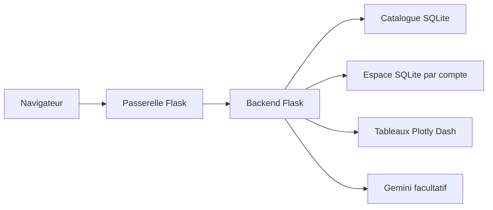

# Mihna — Documentation technique

## Démarrage local

Sous Windows, `INSTALLER_WINDOWS.bat` prépare l’environnement Python. `LANCER_MON_PROJET.bat` vérifie l’installation et lance la passerelle sur `http://127.0.0.1:5000`. Le backend écoute sur la boucle locale au port 5101. Pour une présentation sans données personnelles, utiliser le mode public isolé décrit dans le guide de lancement.

## Architecture et données



La passerelle gère l’inscription, les sessions et le relais authentifié vers le backend. Les pages HTML et modules JavaScript de `dashboard/` interrogent les API. Le parcours utilisateur partage les identifiants du CV et de l’offre entre le matching, la préparation du CV ciblé et le suivi de candidature. Dash s’appuie sur l’espace actif sélectionné par le serveur.

Le catalogue et les espaces utilisent le schéma SQLite v11. La collecte conserve la source, l’identifiant externe, l’URL et les dates disponibles. L’ETL normalise les champs et compare les identités avant insertion. Les champs manquants restent indéterminés. Les identités légales issues de GLEIF sont consultables séparément du catalogue des recruteurs.

## Sécurité et exploitation

Conserver les variables locales dans l’environnement et les sauvegardes en dehors de tout paquet public. Garder ensemble les fichiers SQLite et les éléments requis pour relire les données privées. Vérifier les sauvegardes avec les commandes SQLite d’intégrité et de clés étrangères. Utiliser une copie isolée pour les essais de migration.

Gemini est facultatif. Les enrichissements concernés utilisent un aperçu, un consentement et une validation de réponse. Le matching local reste disponible sans l’appel distant. La fonctionnalité Search Grounding est désactivée pour cette remise. L’envoi d’alertes exige une configuration SMTP active et le consentement enregistré.

## Parcours à expliquer au jury

| Parcours | Entrée | Traitement et sortie |
|---|---|---|
| Authentification | Formulaires de `auth_gateway/templates/` | `auth_gateway/app.py` contrôle les données, crée la session et relaye les requêtes. `auth_gateway/security.py` hache et vérifie le mot de passe. |
| CV Studio | Formulaire de `dashboard/js/cv-studio.js` | `POST /api/cvs` valide et persiste le CV. `GET /api/cvs/<id>/pdf` compose le PDF. Les routes de prévisualisation permettent de contrôler la présentation avant export. |
| Matching | Sélection de l’offre et du CV | `POST /api/matching` restitue scores et explications. Les écarts de compétence et les données manquantes se lisent avec le résultat. |
| CV ciblé | Offre, CV de départ et choix validés | Les routes `/api/cvs/tailored` calculent un aperçu et enregistrent une version liée. Le CV de départ conserve son identifiant. |
| Candidature | Fiche ouverte ou formulaire de suivi | `POST /api/offres/<id>/apply` prépare une candidature suivie. `PATCH /api/candidatures/<id>` actualise son statut et alimente l’historique. |
| Entretien | Contexte du candidat et réponses | Les routes `/api/career/interviews` et `/api/career/interview-drafts` gèrent la préparation et l’historique. L’enrichissement Gemini éventuel passe par un aperçu et une validation. |
| Collecte | Flux, fichier ou données validées par l’utilisateur | Le backend prépare des lignes en attente dans `collector_staging`. Les décisions et l’import contrôlent l’identité, les doublons, les liens et la provenance. |
| Analytics | Espace actif et historiques | `backend/analytics.py` construit le tableau Dash. Les routes de candidature et de tableau de bord calculent leurs indicateurs dans le contexte du compte. |

## Commandes de vérification

```powershell
.\.venv\Scripts\python.exe -m pytest tests auth_gateway/tests -q
.\.venv\Scripts\python.exe scripts/phase12_browser.py
```

La seconde commande requiert Playwright et Microsoft Edge. Elle crée un environnement temporaire, démarre la passerelle et le backend sur des ports de test, puis détruit ses propres données en fin d’exécution.

Pour une restauration, arrêter uniquement les services Mihna identifiés, copier le fichier SQLite de destination hors de son chemin courant et restaurer une sauvegarde validée avec les éléments privés correspondants. Vérifier `PRAGMA integrity_check` et `PRAGMA foreign_key_check` avant de relancer. Pour un diagnostic HTTP, vérifier d’abord `/health` sur les deux services, puis l’authentification et la réponse JSON de la route appelée.

## Contrats API utilisés dans la démonstration

Les appels se font depuis une session authentifiée par la passerelle. Pour les mutations, reprendre le jeton CSRF fourni par la session. Le mode de démonstration synthétique applique ses propres restrictions de lecture seule.

| Appel | Entrée et résultat | Erreur ou garde à démontrer |
|---|---|---|
| `GET /api/offres` | Catalogue normalisé, état de disponibilité et champs de provenance lorsque la source les fournit. | La passerelle renvoie HTTP 401 hors session. Une date ou une ville indéterminée est affichée comme telle. |
| `POST /api/cvs` | Objet JSON contenant `name`, `template` et `data`. Le serveur valide puis chiffre `data`, ajoute une ligne à `cvs` et renvoie HTTP 201 avec `id`. | La validation rejette un nom vide ou un modèle inconnu. |
| `GET /api/cvs/<id>/pdf` | Identifiant du CV de l’espace actif. Lecture et déchiffrement par le backend, puis composition du PDF sélectionné. | Un identifiant d’un autre espace ne permet pas de lire ce CV. |
| `POST /api/matching` | Calcule un classement sur le CV et les critères transmis. La réponse contient `mode`, `notice`, `results` et `disclaimer`. | Pour `mode=gemini`, le consentement et l’empreinte de l’aperçu sont obligatoires. En cas d’échec distant, les résultats locaux restent disponibles. |
| `POST /api/offres/<id>/apply` | Exemple de préparation avec `{"cv_id":1,"action":"prepare","confirmed":true}` pour un CV réel de l’espace de test. Le backend vérifie l’offre, le CV validé et la confirmation, puis enregistre le suivi. | Un second envoi de la même demande renvoie l’identifiant de suivi existant et `duplicate=true`. |

## Références de maintenance

- [Architecture, routes et composants](TECHNICAL_DOCUMENTATION.md)
- [Inventaire des fichiers, symboles et routes](INVENTAIRE_CODE_ET_ROUTES.md)
- [Référence HTTP, entrées, réponses et contrôles](REFERENCE_API_MIHNA.md)
- [Index commenté des fonctionnalités et tests](INDEX_FONCTIONNALITES_CODE.csv)
- [Schéma et migrations](BASE_DE_DONNEES.md)
- [ETL et contrôles qualité](ETL_ET_NETTOYAGE.md)
- [Provenance et droits des sources](DATA_SOURCES_AND_PROVENANCE.md)
- [Tests et périmètre](FINAL_TEST_RESULTS.md)
- [Exploitation et déploiement](DEPLOYMENT_REPORT.md)
